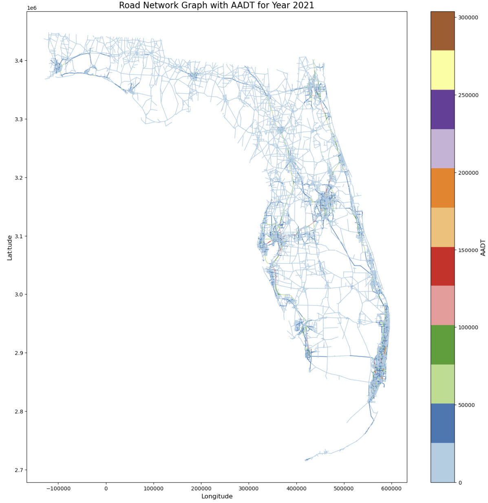
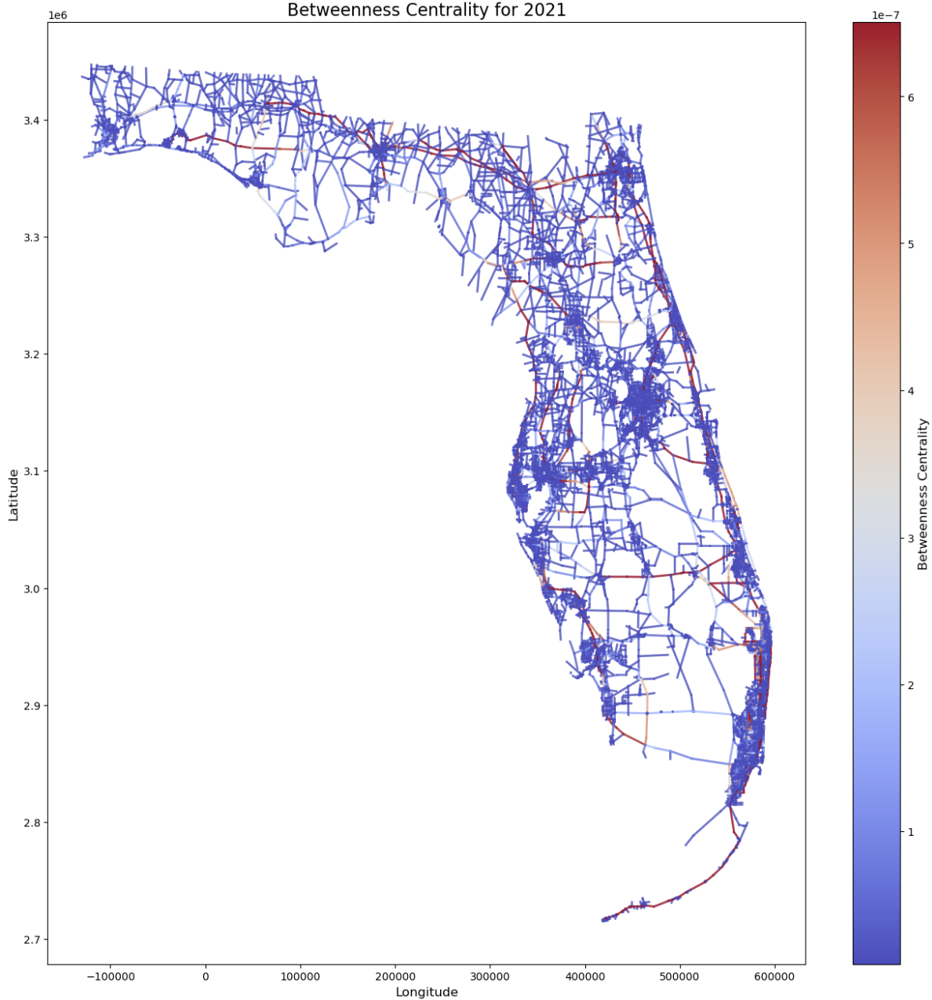
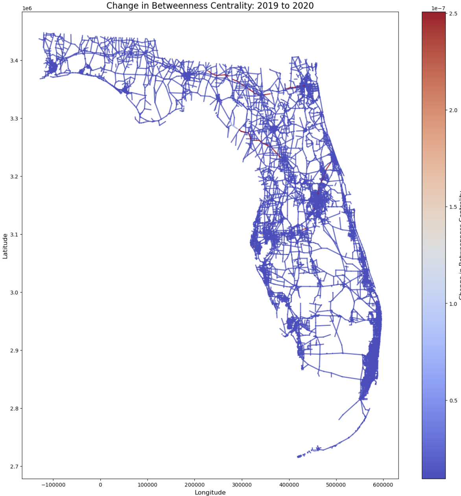

# Traffic Network Centrality: Florida Road Network vs. Measured Traffic

Graph-based analysis of Florida's state road network: each road segment becomes an edge, edge
betweenness centrality is computed for each year from 2019 to 2023, and the results are compared
with FDOT's measured Annual Average Daily Traffic (AADT). Louvain community detection is also applied.

Final project for **ECE 735 – Fundamentals of Network Science**, University of Miami (Fall 2024),
by Matteo De Angelis. The full write-up is in [`report/final_report.pdf`](report/final_report.pdf)
(source: [`report/final_report.docx`](report/final_report.docx)).

## Question

Which road segments act as structural bottlenecks of the Florida network? Do they match the roads
that actually carry the most traffic? And how did their importance change from 2019 to 2023?

## Data

- **FDOT Historical Annual Average Daily Traffic** (`aadt_historical` shapefile), published by the FDOT
  Transportation Data & Analytics Office.
  ArcGIS item: <https://fdot.maps.arcgis.com/home/item.html?id=96c6f10bac1b4dd59115d5a5627bbd95>
  · download: <https://ftp.fdot.gov/file/d/FTP/FDOT/co/planning/transtat/gis/shapefiles/aadt_historical.zip>
  (FDOT's metadata says to log in with the username `Guest`). The full field metadata is in
  [`data/aadt_historical_metadata.pdf`](data/aadt_historical_metadata.pdf).
- The snapshot used here has **100,814 road-segment records** for the years 2019–2023. Each record has
  a year, a roadway ID, from/to descriptions, mileposts, AADT, the segment length in meters (`Shape_Leng`)
  and a line geometry.
- The raw shapefile is **not** in this repository. Download it and unzip it to `data/aadt_historical/`.

## Method

1. **Graph construction** (NetworkX). The first and last coordinates of each segment geometry become
   nodes, and the segment becomes an edge. Endpoints that coincide are merged into one node, which is
   how the network stays connected. All years go into a single `MultiGraph` whose edge key is the year.
2. **Per-year subgraphs.** For each year, that year's edges are extracted into a simple `nx.Graph`
   with the `AADT` and `Shape_Leng` attributes.
3. **Edge betweenness centrality.** `nx.edge_betweenness_centrality(G, normalized=True)` is exact,
   with no source sampling. It is computed three ways for each year: unweighted, weighted by `AADT`,
   and weighted by `Shape_Leng`. Each yearly run took about 1,400–3,000 s, so each variant took about
   2–2.5 hours for the five years.
4. **Temporal change.** For edges present in both years, the per-edge centrality difference is
   computed between consecutive years and for 2019→2023. Each difference is mapped onto the network.
5. **Comparison with AADT.** The centrality maps are compared side by side with the AADT map for the
   same year.
6. **Community detection.** Louvain (`python-louvain`) runs on the AADT-weighted yearly graph.

## Results

From the report:

- **Bottlenecks match the busiest roads.** With centrality weighted by segment length, the
  highest-centrality segments are the roads connecting urban centers to the wider state network.
  The report finds that these segments often coincide with the highest-AADT roads, so the shortest
  routes are also the most heavily used.
- **Temporal change.** The largest shifts in AADT-weighted centrality occurred in 2019→2020 and
  2022→2023. The report attributes 2019→2020 to COVID-19 travel restrictions. It also notes changes
  on roads linking Jacksonville and Tallahassee and on Route 19 and I-4 between Orlando and Daytona
  Beach. In 2022→2023, centrality increased on I-10 between Jacksonville and Tallahassee, which the
  report reads as a return toward pre-pandemic patterns.
- **Communities.** With the default Louvain resolution (r = 1), the algorithm found over 10,000
  communities. With r = 100, the clusters were larger and easier to interpret. Because AADT varies
  little from year to year, the communities stayed stable across years.
- **Implication.** Roads that connect cities to the state network carry the most traffic and are also
  the main evacuation routes. That makes them a weak point during hurricanes.

| AADT, 2021 (report Fig. 3) | Edge betweenness centrality, 2021 (report Fig. 4) |
|---|---|
|  |  |

<p align="center">
  <br>
  <em>Change in edge betweenness centrality, 2019 → 2020.</em>
</p>

More figures are in [`docs/`](docs/): the raw segment geometries (`florida-roads.png`) and the
endpoint graph (`road-network-graph.png`).

## Repository layout

```
notebooks/implementation.ipynb   main analysis: graph construction, betweenness, temporal change, Louvain
notebooks/tests.ipynb            early exploration of other FDOT layers (traffic-count sites,
                                 basemap routes); not used for the final results
report/final_report.{docx,pdf}   IEEE-style project report (the PDF is exported from the .docx)
data/                            precomputed edge betweenness per year (JSON) + FDOT metadata PDF
docs/                            figures used in the report and this README
```

Precomputed results (`data/*.json`, each about 10–11 MB) have the format
`{"<year>": {"(<node u>, <node v>)": centrality}}`, where a node is an `(x, y)` coordinate tuple:

| File | Contents |
|---|---|
| `betweenness_centrality_kgb.json` | unweighted, computed on the per-year simple graphs |
| `betweenness_by_year_with_aadt.json` | weighted by `AADT` |
| `betweenness_by_year_with_shape_len.json` | weighted by `Shape_Leng` (meters) |
| `betweenness_centrality.json` | earlier unweighted run; the edge keys also include the MultiGraph key |

## How to run

```bash
python -m venv .venv && source .venv/bin/activate   # the notebooks were run on Python 3.9
pip install -r requirements.txt
# download aadt_historical.zip (see Data) and unzip it to data/aadt_historical/
jupyter notebook notebooks/implementation.ipynb
```

Computing exact betweenness for five years takes hours. To skip it, load the precomputed results with
`load_betweenness_from_file("../data/<file>.json")`. The notebook was developed interactively, and some
cells use variables defined further down. Running it top to bottom may require reordering a few cells.

## Limitations

- **Visual comparison only.** Centrality is compared with AADT by looking at maps side by side.
  No correlation statistic was computed.
- **Topology, not demand.** Betweenness counts shortest paths between all node pairs. It is purely
  topological and does not model where trips actually start and end.
- **Weights are distances.** NetworkX treats edge weights as distances. In the AADT-weighted runs,
  busier segments therefore count as "longer" for shortest paths.
- **Exact-coordinate nodes.** Two segments are connected only if their endpoint coordinates match
  exactly.
- **Rolling data window.** FDOT's layer always holds the five most recent years and is updated weekly.
  A fresh download will not cover the 2019–2023 window analyzed here.
- **No speed data.** The analysis uses AADT and segment length only. The report names vehicle-speed
  data as the next step for modeling traffic dynamics, for example during evacuations.
